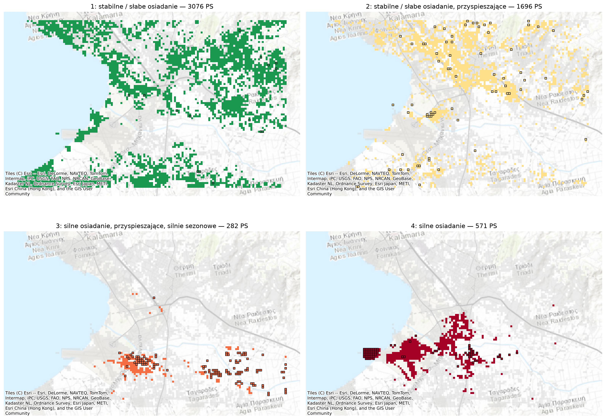

# Deformacje terenu w Salonikach — EGMS, anomalie i klasy punktów PS

Projekt grupowy: **Kamila Matynia, Rafał Złoza, Amelia Hajduga**

Analiza przemieszczeń terenu w południowo-wschodniej części aglomeracji Salonik (Kalamaria, Thermi, lotnisko Makedonia, Tagarades) na podstawie danych **EGMS Ortho (2020–2024)**:

1. wykrywanie nietypowych punktów PS — **Isolation Forest**,
2. podział punktów na **4 klasy zachowania** — **K-means**,
3. mapa klas i anomalii,
4. powiązanie wyników z **budynkami** (EUBUCCO),
5. interpretacja.

## Najważniejsze wyniki

| klasa | PS | mediana prędkości | anomalie | lokalizacja |
|---|---|---|---|---|
| 1: stabilne / słabe osiadanie | 3076 | −1,3 mm/rok | 0,5% | Kalamaria, Nea Krini, Thermi, Triadi |
| 2: słabe osiadanie, przyspieszające | 1696 | −1,6 mm/rok | 4,2% | rozproszone, głównie północ obszaru |
| 3: silne osiadanie, przyspieszające, silnie sezonowe | 282 | −8,6 mm/rok | 41,8% | równina rolnicza na południe od lotniska (Tagarades, Agia Paraskevi) |
| 4: silne osiadanie | 571 | −10,0 mm/rok | 13,7% | pas od wybrzeża przy lotnisku na wschód |

- 282 PS (5%) oznaczono jako anomalie; skupiają się w strefie silnego osiadania.
- 18 684 z 21 846 budynków ma PS w odległości ≤ 50 m; ok. 1500 budynków leży w strefach silnego osiadania, 375 przy PS anomalnym.
- Sezonowy charakter osiadania klasy 3 wskazuje na pobór wód podziemnych jako prawdopodobną przyczynę.

Pełna interpretacja i ograniczenia: ostatnia sekcja notatnika.



## Struktura

```
data/do_colaba/      dane wejściowe: thessaloniki_points.csv, thessaloniki_buildings.gpkg
data/przyciete/      te same dane jako shapefile (QGIS)
notebooks/EGMS_Thessaloniki_projekt.ipynb   cała analiza
notebooks/archiwum/  wcześniejsze wersje notatników (z zajęć)
results/             wyniki CSV i GPKG
maps/                mapy PNG, mapa interaktywna HTML, wykresy
qgis/                projekt QGIS (EGMS_Thessaloniki.qgz) z gotowymi stylami i wydrukami
presentation/        prezentacja (PDF) i notatki do wystąpienia
```

| plik wynikowy | zawartość |
|---|---|
| `results/EGMS_Thessaloniki_PS_results.csv` | wszystkie PS: cechy, `anomaly_score`, `anomaly` (0/1), `cluster`, `cluster_name` |
| `results/EGMS_Thessaloniki_PS_results.gpkg` | warstwy QGIS: `PS_punkty`, `PS_komorki_100m` |
| `results/budynki_EGMS_results.gpkg` / `.csv` | budynki z przypisanym najbliższym PS |
| `results/budynki_wymagajace_uwagi.csv` | budynki przy PS anomalnym lub w klasach 3–4 |
| `results/podsumowanie_klas.csv`, `podsumowanie_budynkow.csv` | tabele podsumowujące |
| `maps/mapa_interaktywna_PS.html` | mapa do otwarcia w przeglądarce |

## Uruchomienie

```bash
pip install -r requirements.txt
jupyter notebook notebooks/EGMS_Thessaloniki_projekt.ipynb
```

Notatnik uruchamiamy od góry do dołu. W Google Colab wystarczy wgrać obok notatnika `thessaloniki_points.csv` i `thessaloniki_buildings.gpkg`.

## Dane

- EGMS — European Ground Motion Service, Copernicus: https://egms.land.copernicus.eu/
- EUBUCCO v0.2 — budynki: https://eubucco.com/data/download/v0.2
